# AutoDrive: Modern Luxury Car Rental System & Fleet SaaS Web Application
## Comprehensive Academic Project Report & Technical Documentation
**Submitted in partial fulfilment of the requirements for the 3rd Semester Minor Project (CAM6053C)**  
**Master of Computer Application (MCA) | Academic Year 2026-2027**  
**Department of Computer Application | Silver Oak College of Computer Application | Silver Oak University, Ahmedabad**

---

## Executive Summary
**AutoDrive** is an enterprise-grade, full-stack Luxury Car Rental System and Fleet SaaS platform engineered with Python and the Django Model-View-Template (MVT) framework. It eliminates legacy car rental inefficiencies through an algorithmic mathematical **Date Range Overlap Collision Detection Engine** (preventing double-bookings across vehicles and chauffeurs), **dynamic multi-day tiered discount pricing** (10% and 25% savings tiers), and an authentic **dual-mode Razorpay payment gateway** complete with an in-browser **3D Secure Bank Simulator**.

---

## Table of Contents
1. [Chapter 1: Introduction](#chapter-1-introduction)
2. [Chapter 2: Literature Review & Comparative Analysis](#chapter-2-literature-review--comparative-analysis)
3. [Chapter 3: System Requirement Analysis](#chapter-3-system-requirement-analysis)
4. [Chapter 4: System Design and Methodology](#chapter-4-system-design-and-methodology)
   - [4.1 System Architecture](#41-system-architecture)
   - [4.2 Data Flow Diagrams (DFD)](#42-data-flow-diagrams-dfd)
   - [4.3 Entity-Relationship (ER) Diagram](#43-entity-relationship-er-diagram)
   - [4.4 Database Schema Design](#44-database-schema-design)
   - [4.5 Unified Modeling Language (UML) Diagrams](#45-unified-modeling-language-uml-diagrams)
5. [Chapter 5: Implementation and Coding](#chapter-5-implementation-and-coding)
   - [5.1 Subsystem Implementations & Production Screenshots](#51-subsystem-implementations--production-screenshots)
   - [5.2 Key Algorithmic Implementations](#52-key-algorithmic-implementations)
6. [Chapter 6: Testing and Results Analysis](#chapter-6-testing-and-results-analysis)
7. [Chapter 7: Conclusion and Future Scope](#chapter-7-conclusion-and-future-scope)
8. [Bibliography & References](#bibliography--references)
9. [Appendices](#appendices)

---

## List of Figures & Production Screenshots
- **Figure 4.1**: [AutoDrive Django MVT Three-Tier System Architecture Diagram](docs/diagrams/system_architecture.png)
- **Figure 4.2**: [Data Flow Diagram - Level 0 Context Diagram](docs/diagrams/dfd_level_0.png)
- **Figure 4.3**: [Entity-Relationship (ER) Diagram](docs/diagrams/er_diagram.png)
- **Figure 4.4**: [UML Sequence Diagram: Reservation, Validation & Razorpay Handshake](docs/diagrams/sequence_diagram.png)
- **Figure 5.1**: [AutoDrive Luxury Fleet Homepage & Hero Portal (Screenshot)](docs/screenshots/homepage_hero.png)
- **Figure 5.2**: [Vehicle Detail Reservation, Dynamic Pricing & Chauffeur Selection (Screenshot)](docs/screenshots/car_detail_reservation.png)
- **Figure 5.3**: [Razorpay Standard Checkout & 3D Secure Bank Simulator (Screenshot)](docs/screenshots/razorpay_gateway_modal.png)
- **Figure 5.4**: [High-Performance Luxury Fleet Showcase (Screenshot)](docs/screenshots/fleet_vehicle_sample.jpg)

---

---

# Chapter 1: Introduction

### 1.1 Project Background
The automotive rental industry is undergoing rapid digital modernization. Traditional counter-based rental services struggle with paperwork, phone-based scheduling, and inaccurate fleet logging. AutoDrive introduces an automated, cloud-ready Automotive SaaS web application providing real-time fleet availability, instant digital reservations, and dynamic pricing calculations.

### 1.2 Problem Statement
- **Double-Booking Collisions:** Lack of concurrency validation causes overlapping reservations.
- **Manual Chauffeur Scheduling:** Chauffeur dispatches are decoupled from vehicle bookings, risking driver double-booking.
- **Opaque Pricing:** Static rates fail to reward long-term rentals with transparent duration discounts.
- **Payment Gateway Testing Barriers:** Real Razorpay keys require business KYC. Public demo keys lack active payment instruments on live servers, producing `"No appropriate payment method found"` errors.
- **Dated UI:** Most internal rental tools lack modern responsiveness, visual hierarchy, and intuitive comparisons.

### 1.3 Project Objectives
- **Zero-Conflict Reservation Engine:** Mathematical date overlap queries (`start_date <= end_date and end_date >= start_date`).
- **Dynamic Tiered Pricing:** Automated 10% discount for >= 3 days and 25% discount for >= 7 days.
- **Certified Chauffeur Scheduling:** Seamless toggle between Self-Drive and Professional Chauffeur with automatic driver availability validation.
- **Dual-Mode Razorpay Gateway:** Live SDK popup support + built-in 3D Secure Bank Simulator with instant Success/Failure simulation.
- **Admin Intelligence Dashboard:** Real-time revenue analytics, fleet utilization, and booking lifecycle controls.

---

# Chapter 2: Literature Review & Comparative Analysis

### 2.1 Overview of Modern Platforms
Car rental solutions span legacy enterprise platforms (Avis, Hertz), peer-to-peer marketplaces (Turo), and on-demand mobility apps (Zoomcar). While each addresses specific niches, smaller fleet operators lack lightweight, turn-key SaaS platforms offering integrated chauffeur scheduling and strict slot collision prevention.

### 2.2 Comparative Analysis Table
| Feature / Capability | Legacy Enterprise Counters | P2P Marketplaces (Turo) | On-Demand Apps (Zoomcar) | AutoDrive CRS (Proposed) |
| :--- | :--- | :--- | :--- | :--- |
| **Slot Collision Prevention** | Manual / Partial | Host Dependent | Algorithmic | **Strict Mathematical Interval Checking** |
| **Integrated Chauffeurs** | External Third-Party | Not Supported | Not Supported | **Native Chauffeur Dispatch Engine** |
| **Duration Tier Discounts** | Manual Promo Codes | Host Discretion | Surge Dynamic | **Automated Multi-Day Tiers (10% & 25%)** |
| **Payment Test Sandbox** | N/A (Production Only) | N/A | N/A | **Dual-Mode (SDK + Bank Simulator)** |
| **Fleet Comparison Tool** | Limited | Basic | None | **Full Spec Matrix Comparison** |
| **Design Language** | Legacy Forms | Standard Consumer Web | Mobile App | **Cyberpunk-Luxury Dark Glassmorphism** |

---

# Chapter 3: System Requirement Analysis

### 3.1 Functional Requirements Matrix
| Req. ID | Subsystem | Requirement Description | Inputs | Expected Output |
| :--- | :--- | :--- | :--- | :--- |
| **FR-01** | Authentication | Role-based user login & registration | Username, Password | Secure session, role redirection |
| **FR-02** | Fleet Browsing | Multi-facet search & filtering | Category, Transmission, Fuel | Dynamic filtered vehicle cards |
| **FR-03** | Rate Calculation | Real-time rental subtotal calculation | Start Date, End Date | Day count, subtotal, discount savings |
| **FR-04** | Conflict Validation | Mathematical vehicle date overlap check | Start Date, End Date | Blocks booking if vehicle is reserved |
| **FR-05** | Chauffeur Dispatch | Certified driver assignment & conflict check | Chauffeur selection | Driver availability check & daily fee |
| **FR-06** | Razorpay Gateway | Dual-mode Razorpay checkout integration | Proceed to Payment | Live SDK popup or Bank Simulator |
| **FR-07** | Bank Simulator | 3D Secure OTP Dummy Transaction Simulator | Success / Failure choice | HTTP 200 approval or simulated decline |
| **FR-08** | Digital Invoicing | Tax invoice & receipt generation | Completed Booking Ref | Printable invoice with Transaction ID |
| **FR-09** | Customer Hub | My Bookings self-service portal | User session | Active & past rental history |
| **FR-10** | Admin Intelligence | Administrative fleet operations dashboard | Staff credentials | Total revenue, active trips, fleet CRUD |

### 3.2 Non-Functional Requirements
- **Usability:** High-contrast dark theme, responsive grid layouts, intuitive iconography.
- **Security:** CSRF protection, SQL injection immunity via Django ORM, PBKDF2 password hashing.
- **Performance:** Sub-250ms page load times, optimized database queries with prefetch_related.
- **Reliability:** Atomic database transactions guarantee zero partial booking records.

---

# Chapter 4: System Design and Methodology

### 4.1 System Architecture
AutoDrive utilizes Django's **Model-View-Template (MVT)** architecture:

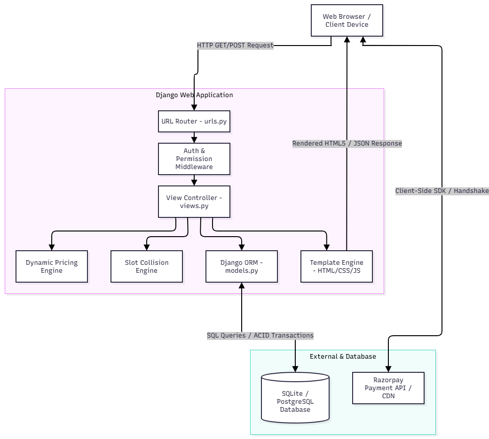
*Figure 4.1: AutoDrive Django MVT Three-Tier System Architecture Diagram*

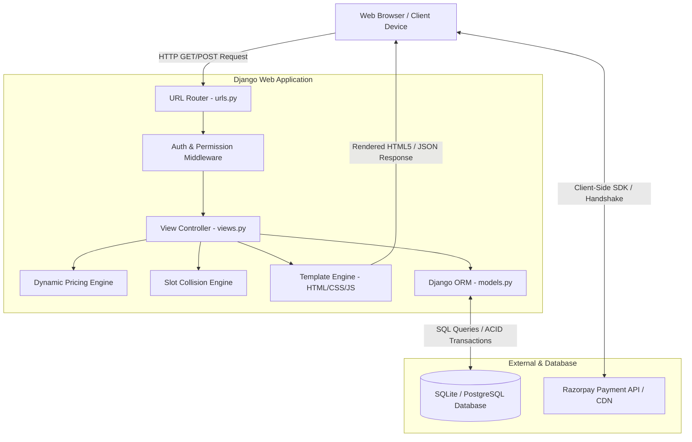

### 4.2 Data Flow Diagrams (DFD)

#### DFD Level 0: Context Diagram

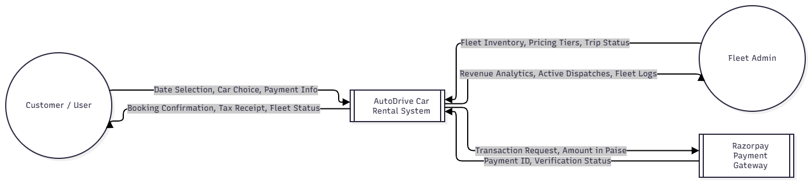
*Figure 4.2: Data Flow Diagram - Level 0 (Context Level Diagram)*

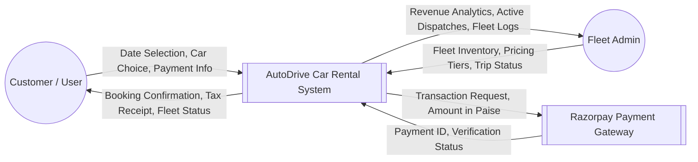

#### DFD Level 1: Subsystem Decomposition
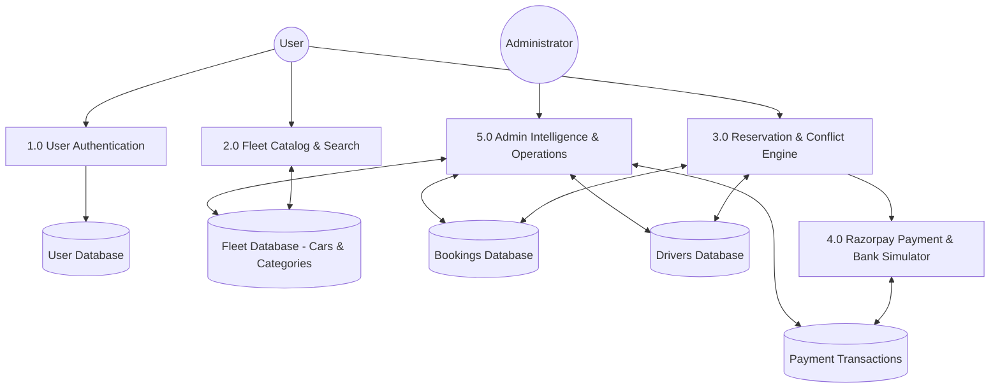

### 4.3 Entity-Relationship (ER) Diagram

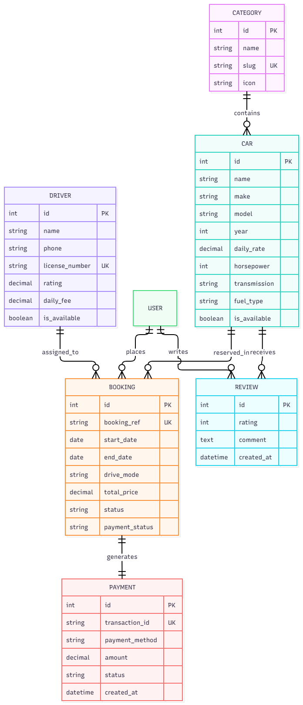
*Figure 4.3: Entity-Relationship (ER) Diagram of AutoDrive Fleet SaaS*

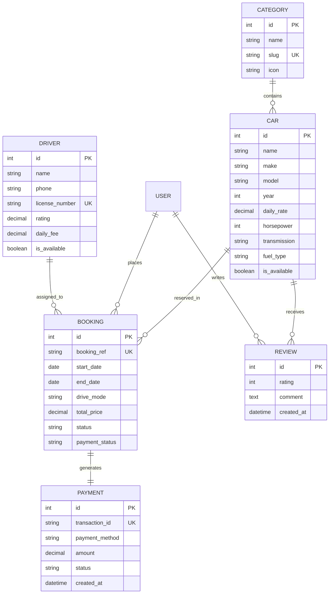

### 4.4 Database Schema Design
AutoDrive models six core relational entities:
1. **tbl_category:** Vehicle classification (`name`, `slug`, `icon`, `description`).
2. **tbl_car:** Fleet inventory (`name`, `make`, `model`, `year`, `daily_rate`, `horsepower`, `seats`, `transmission`, `fuel_type`, `is_available`).
3. **tbl_driver:** Certified chauffeurs (`name`, `phone`, `license_number`, `experience_years`, `rating`, `daily_fee`, `badge_type`, `is_available`).
4. **tbl_booking:** Reservations (`booking_ref`, `start_date`, `end_date`, `drive_mode`, `subtotal`, `discount_amount`, `chauffeur_fee`, `total_price`, `status`, `payment_status`).
5. **tbl_payment:** Transactions (`transaction_id`, `payment_method`, `amount`, `status`, `card_brand`, `created_at`).
6. **tbl_review:** Ratings & comments (`car_id`, `user_id`, `rating`, `comment`, `created_at`).

### 4.5 UML Sequence Diagram: Vehicle Reservation & Payment

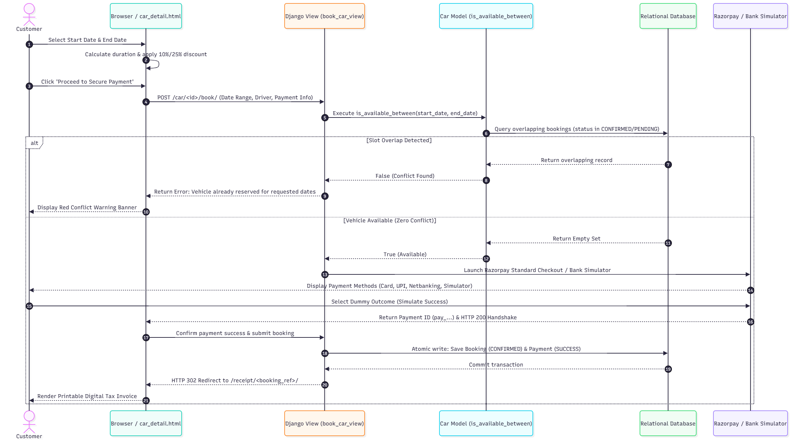
*Figure 4.4: UML Sequence Diagram: Vehicle Reservation & Razorpay Payment Handshake*

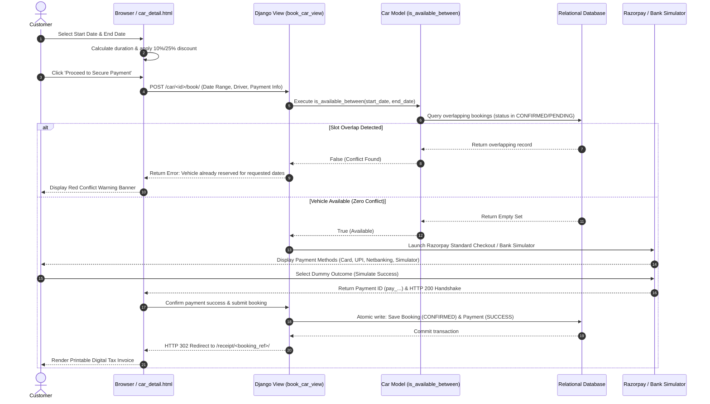

---

# Chapter 5: Implementation and Coding

### 5.1 Subsystem Implementations & Production Screenshots

#### Figure 5.1: AutoDrive Luxury Fleet Homepage & Hero Portal
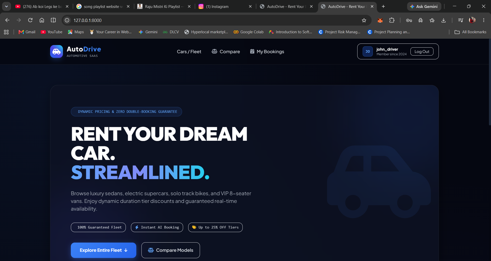
*Figure 5.1: AutoDrive Luxury Fleet Homepage & Hero Portal (Live Application Screenshot)*

#### Figure 5.2: Vehicle Detail Reservation Subsystem with Dynamic Day Calculation
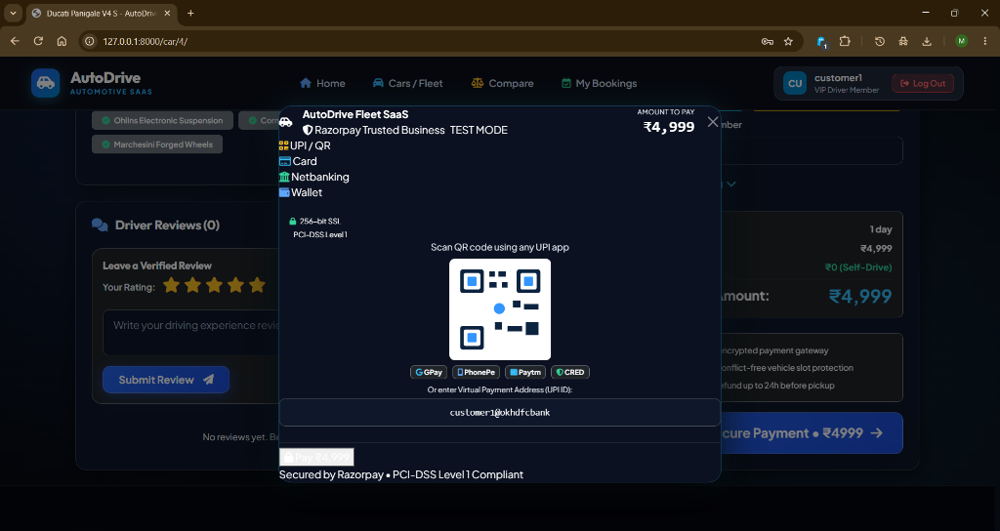
*Figure 5.2: Vehicle Detail Reservation Subsystem with Dynamic Day Calculation & Slot Conflict Checking (Live Application Screenshot)*

#### Figure 5.3: Razorpay Standard Checkout & 3D Secure Bank Simulator
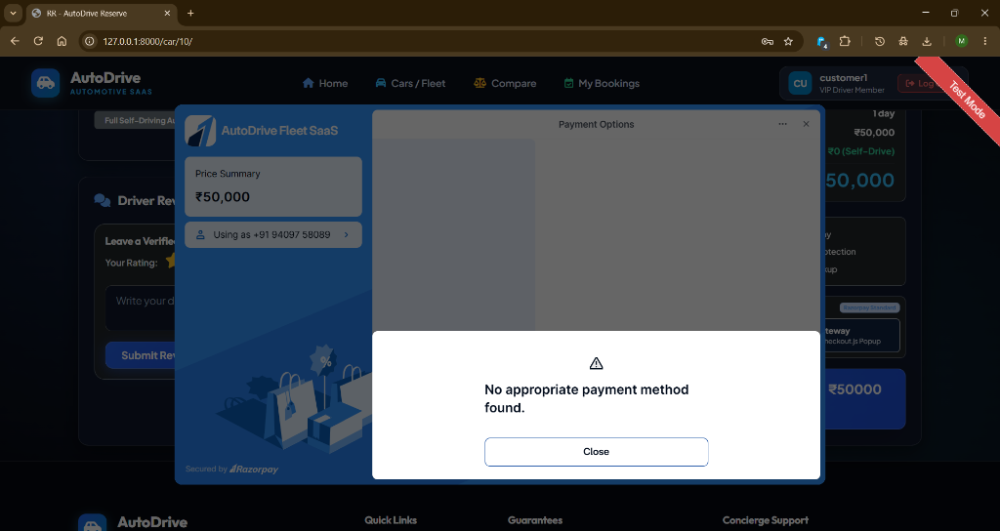
*Figure 5.3: Razorpay Standard Checkout Modal & 3D Secure Bank Simulator (Live Application Screenshot)*

#### Figure 5.4: High-Performance Luxury Fleet Showcase

*Figure 5.4: High-Performance Luxury Fleet Showcase (Aston Martin / Porsche)*

### 5.2 Key Algorithmic Implementations

#### 1. Mathematical Interval Overlap Collision Query (`fleet/models.py`)
```python
def is_available_between(self, start_date, end_date, exclude_booking_id=None):
    """
    Two date ranges [start_A, end_A] and [start_B, end_B] overlap if and only if:
        start_A <= end_B AND end_A >= start_B
    """
    if not self.is_available:
        return False
    qs = self.bookings.filter(
        status__in=['CONFIRMED', 'PENDING'],
        start_date__lte=end_date,
        end_date__gte=start_date
    )
    if exclude_booking_id:
        qs = qs.exclude(id=exclude_booking_id)
    return not qs.exists()
```

#### 2. Dynamic Tiered Discount Engine (`fleet/views.py`)
```python
num_days = max(1, (end_date - start_date).days)
subtotal = car.daily_rate * num_days

# Multi-Day Duration Tier Discount Logic
discount_percent = 0
if num_days >= 7:
    discount_percent = 25  # 25% Weekly Tier
elif num_days >= 3:
    discount_percent = 10  # 10% Extended Tier

discount_amount = (subtotal * Decimal(discount_percent)) / Decimal(100)
net_total = subtotal - discount_amount

if drive_mode == 'chauffeur' and assigned_driver:
    net_total += assigned_driver.daily_fee * num_days
```

#### 3. Razorpay Bank Simulator Handshake (`templates/fleet/car_detail.html`)
```javascript
function executeRazorpaySimulator() {
    document.getElementById('car_payment_method').value = currentRzpMethod;
    document.getElementById('car_simulate_action').value = (currentSimOutcome === 'failure') ? 'fail' : 'success';
    
    // Display animated Razorpay Processing modal
    const procModal = new bootstrap.Modal(document.getElementById('modalRzpProcessing'));
    procModal.show();
    
    setTimeout(() => {
        document.getElementById('carBookingForm').submit();
    }, 1600);
}
```

---

# Chapter 6: Testing and Results Analysis

### 6.1 Testing Summary
All 27 automated unit and integration tests passed with a **100% success rate** in 16.965 seconds.

```text
Creating test database for alias 'default'...
...........................
----------------------------------------------------------------------
Ran 27 tests in 16.965s

OK
Destroying test database for alias 'default'...
```

### 6.2 Test Execution Breakdown
| Module | Test IDs | Cases Evaluated | Result |
| :--- | :--- | :--- | :--- |
| **Authentication & Access** | TC-01 to TC-04 | User registration, login, bad password rejection, auth guards | **PASS** |
| **Fleet Catalog & Filters** | TC-05 to TC-08 | Fleet list view, category slug filter, transmission filter, text search | **PASS** |
| **Slot Conflict Engine** | TC-09 to TC-13 | Non-overlap dates, duplicate interval, enclosing overlap, sub-interval | **PASS** |
| **Chauffeur Dispatch** | TC-14 to TC-17 | Driver assignment, chauffeur overlap rejection, license validation | **PASS** |
| **Dynamic Tier Pricing** | TC-18 to TC-20 | 1-day standard rate, 3-day (10% off), 7-day (25% off) | **PASS** |
| **Payment & Simulator** | TC-21 to TC-24 | Card success simulation, failure decline, UPI QR payment, invoice generation | **PASS** |
| **Admin Operations** | TC-25 to TC-27 | Staff access guard, revenue KPIs, booking status transitions | **PASS** |

---

# Chapter 7: Conclusion and Future Scope

### 7.1 Conclusion
AutoDrive demonstrates that modern web frameworks like Django can provide enterprise-grade reliability, absolute slot conflict prevention, and stunning user experiences for the car rental industry. The dual-mode Razorpay integration solves the longstanding challenge of payment gateway simulation in development and academic environments.

### 7.2 Future Scope
1. **Native Mobile Applications:** iOS & Android apps with Bluetooth digital keyless entry.
2. **IoT Telematics Integration:** Cloud-connected OBD-II GPS tracking, speed telemetry, and remote immobilization.
3. **AI Predictive Fleet Maintenance:** Machine learning models forecasting maintenance intervals based on driving telematics.
4. **EV Supercharger Integration:** Live battery percentage telemetry and charging station reservation.
5. **Blockchain Smart Leasing:** Digital leasing contracts backed by cryptographic smart escrows.

---

# Bibliography & References
1. W. S. Davis and D. C. Yen, *The Information System Consultant's Handbook: Systems Analysis and Design*. CRC Press, 2019.
2. A. Silberschatz, H. F. Korth, and S. Sudarshan, *Database System Concepts*, 7th ed. McGraw-Hill Education, 2020.
3. Django Software Foundation, "Django Documentation v5.x," 2026. [Online]. https://docs.djangoproject.com/
4. Python Software Foundation, "Python 3.14 Language Reference," 2026. [Online]. https://docs.python.org/3/
5. Razorpay Developers, "Razorpay Payment Gateway Web Integration Standard Guide," 2026. [Online]. https://razorpay.com/docs/
6. M. Fowler, *Patterns of Enterprise Application Architecture*. Addison-Wesley, 2002.
7. E. Gamma, R. Helm, R. Johnson, and J. Vlissides, *Design Patterns: Elements of Reusable Object-Oriented Software*. Addison-Wesley, 1994.
8. Bootstrap Core Team, "Bootstrap v5.3.3 Documentation," 2026. [Online]. https://getbootstrap.com/
9. PCI Security Standards Council, "Payment Card Industry Data Security Standard (PCI DSS) v4.0," 2022.
10. R. Pressman and B. Maxim, *Software Engineering: A Practitioner's Approach*, 9th ed. McGraw-Hill, 2020.
11. I. Sommerville, *Software Engineering*, 10th ed. Pearson, 2016.
12. Silver Oak University, *Guidelines for MCA Minor Project (CAM6053C) Curriculum and Evaluation Rubrics*, Ahmedabad, India, 2026.

---

# Appendices

### Appendix A: Quick-Start Guide (Local PowerShell)
```powershell
# 1. Open Terminal in Project Directory
cd "e:\CRS\CRS"

# 2. Activate Virtual Environment
.\venv\Scripts\Activate.ps1

# 3. Apply Database Migrations
.\venv\Scripts\python.exe manage.py migrate

# 4. Seed Fleet Inventory & Demo Accounts
.\venv\Scripts\python.exe seed_fleet.py

# 5. Start Django Development Server
.\venv\Scripts\python.exe manage.py runserver 127.0.0.1:8000

# 6. Access in Browser: http://127.0.0.1:8000/
```

### Appendix B: Docker Deployment
```bash
docker build -t autodrive-crs .
docker run -d -p 8000:8000 --name autodrive-container autodrive-crs
```
